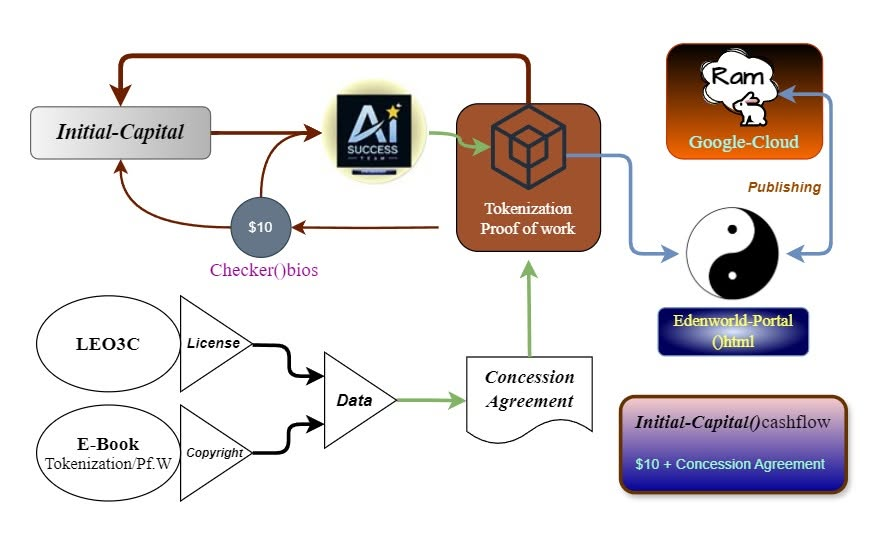

# Absolute-object
Absolute-Recursive-Crystallization-Architecture 

[[Original post (Thai)](https://www.facebook.com/share/p/1QW5sdW3cZ/)](

```markdown
# Absolute Object & The 3 Levels of Truth: Architectural Foundations

This document establishes the foundational ontology for **Absolute Object** and the **3 Levels of Truth**, designed to anchor clarity, eliminate semantic confusion, and guide systemic architecture without drifting into conceptual traps.

---

## Part 1: The 3 Levels of Truth (สัจจะ 3 ระดับ)

To perceive reality without bias or the illusion of linguistic constructs, truth is categorized into three distinct layers:

1. **สามัญสัจจะ (Conventional/Literal Truth):** 
   * *Example:* **[The Sun]** ($[🌞]$) viewed as a large, glowing spherical star that emits light and heat in our immediate perception.
2. **สมมุติสัจจะ (Relative/Phenomenal Truth):** 
   * *Example:* The phenomenon of "the Sun rising in the east and setting in the west" ($[🌝]$ $[🌛]$). This is a relative construct because there is no actual rising or setting of the sun; rather, the observer takes themselves as the fixed coordinate ($Observer$). In reality, the Earth rotates on its axis and revolves around the Sun.
3. **ปรมัตถ์สัจจะ (Absolute Truth):** 
   * *Example:* The ultimate reality where no fixed entity of "sun" or "orbit" exists. It is purely energy and forms of energy ($\lambda Ob \rightarrow \int \propto$), a continuous cycle of name-and-form (*Nama-Rupa*) arising and passing away naturally ($[☄️]$).

---

## Part 2: Rectifying Terminology — "Principle" vs. "Method of Thought"

Language shapes consciousness. A critical error often occurs when compounding terms incorrectly—such as using the phrase **"หลักคิด" (Core Thought)** at an absolute level. 

* **The Flaw in "หลักคิด":** 
  * **หลัก (Principle):** Represents an **Absolute Object** ($Absolute\ Object$)—that which is already established, correct, and immovable.
  * **คิด (Thought):** Represents the movement of consciousness—a comparative method or tool. 
  * Combining an immovable foundation with a moving action creates linguistic and cognitive contradiction.

### The Correct Distinction

* **หลักการ (Principle):** 
  * The **Absolute Object** ($Absolute\ Object$) that remains 100% unmoving and immutable. 
  * *Definition:* Specifications defined to achieve a core intent ($\lambda Ob$). 
* **วิธีคิด (Method/Approach):** 
  * The dynamic tool that must adapt to immediate conditions and available resources without ever compromising the core principle. 
  * *Rule:* There is only **one Principle**, but there can be **a million Methods** to reach that single Principle.

---

## Part 3: Application in System Architecture (AI-Success Case Study)

Applying the **Absolute Object** framework to the **AI-Success** system architecture demonstrates how structural integrity is maintained while operational flexibility is preserved:

* **The Principle (Absolute Object):** 
  * Remains 100% intact—the foundational intent of sharing for systemic success (e.g., keeping resource sharing core to the framework).
* **The Method (วิธีคิด):** 
  * Adjusted dynamically according to current conditions and real-world awareness. For instance, rather than merging operational modules prematurely before formalizing legal foundations (such as a foundation status), the structure holds the allocation within the original principle while pausing direct integration until the timing and environment align correctly.

#License & copyright 


> **Core Axiom:** *Keep the Principle pure and immovable; adapt the Method to align with immediate reality. The Principle does not move; the Method moves to protect the Principle.* $\lambda Ob$

---


